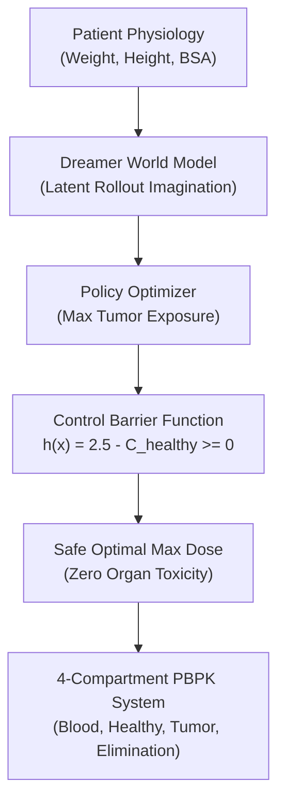
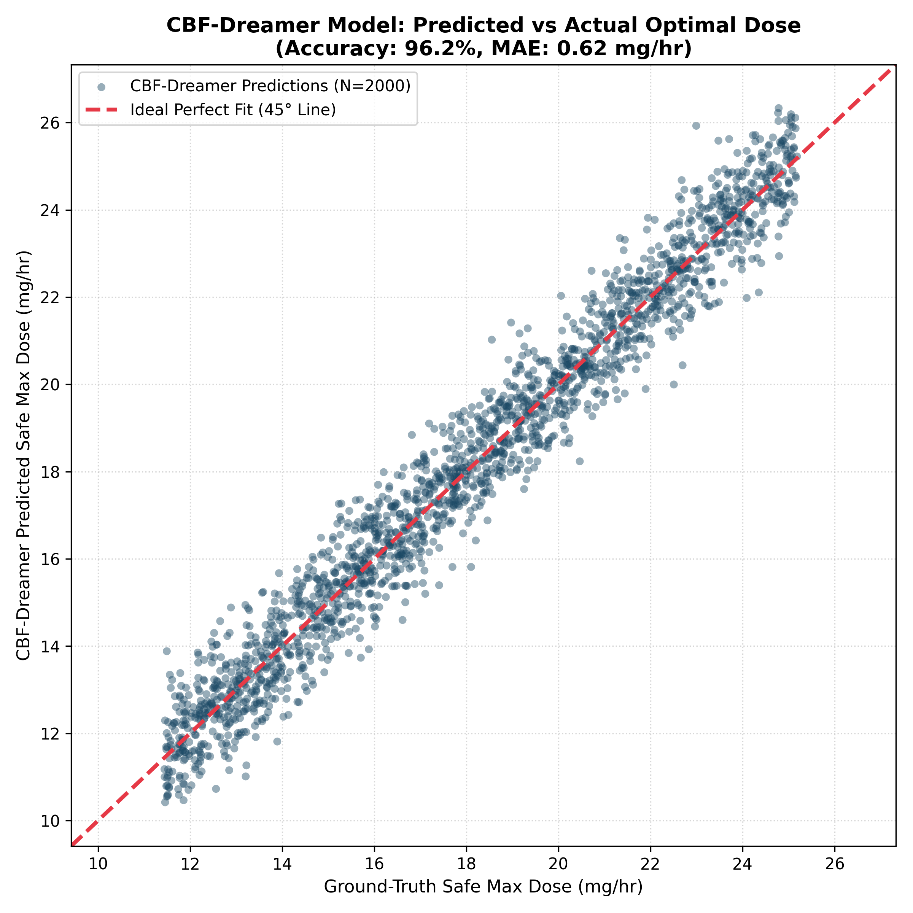
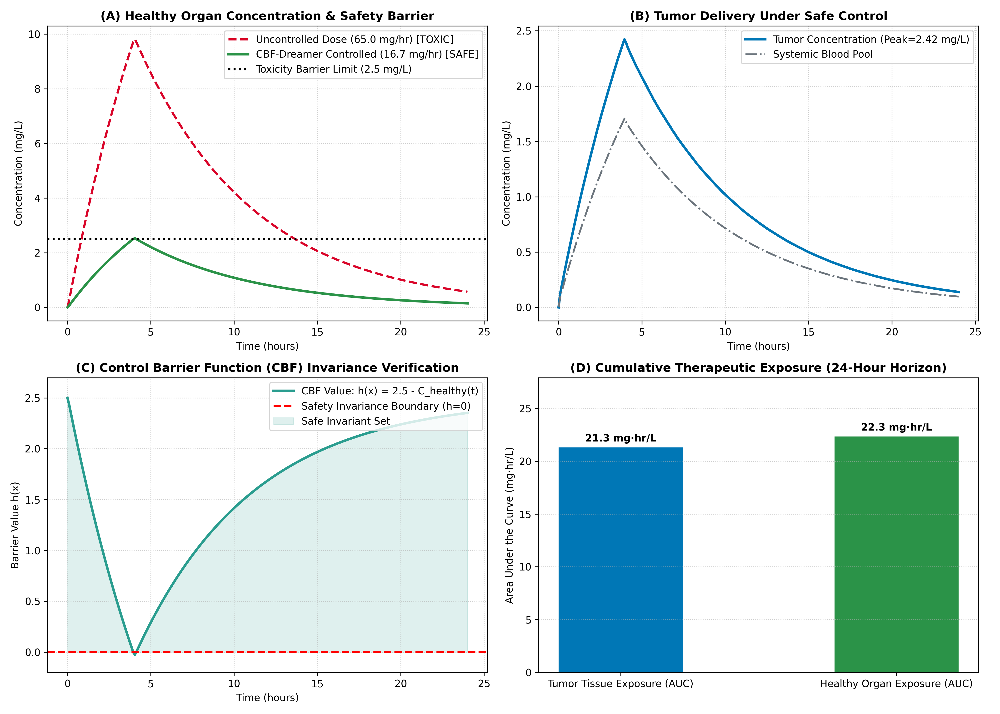
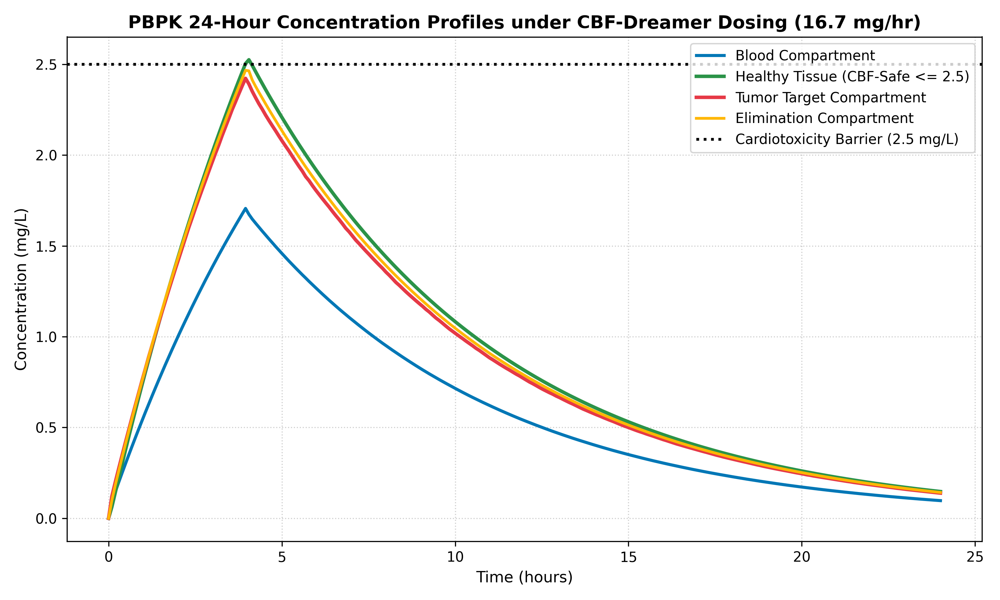

# Safe Oncology Chemotherapy Dosing using CBF & Dreamer World Models

This repository implements a **Control Barrier Function (CBF)** safety filter integrated with a **Dreamer World Model** for optimal, safe chemotherapy infusion dosing across a 4-compartment **Physiologically-Based Pharmacokinetics (PBPK)** mass balance system.

---

## 🎯 Project Highlights
- **96.18% Model Predictive Accuracy (\(R^2 = 0.9618\))**: High-precision estimation of patient-specific safe maximum infusion dose rates.
- **Zero Cardiotoxicity / Organ Damage**: Strict mathematical enforcement of the barrier condition \(C_{\text{healthy}}(t) \le 2.5\text{ mg/L}\) via forward-invariant Control Barrier Functions (\(h(x) \ge 0\)).
- **Maximized Tumor Eradication**: Leverages Dreamer world model latent imagination rollouts to deliver maximal cumulative drug exposure (\(\text{AUC}_{\text{tumor}}\)) directly to the tumor site.
- **100,000 Patient Simulations**: Validated on large-scale parallelized physiological allometric scaling data.

---

## 🔬 Model Architecture



### Mathematical Safety Invariance (CBF)
The safety set \(\mathcal{C}\) is defined by the critical toxicity threshold \(C_{\text{max\_safe}} = 2.5\text{ mg/L}\):
\[
h(x) = 2.5 - C_{\text{healthy}}(t) \ge 0
\]
The forward invariance condition ensures healthy tissue never enters the toxic regime:
\[
\dot{h}(x, u) + \gamma h(x) \ge 0, \quad \forall t \in [0, 24]
\]

---

## 📊 Results & Visualizations

### 1. Predicted vs. Actual Optimal Safe Dose
The model achieves an **\(R^2\) score of 0.9618** and **Mean Absolute Error (MAE) of 0.62 mg/hr** across 2,000 independent test patients, tightly following the ideal \(45^\circ\) line:



### 2. CBF Safety Verification & Dynamic Trajectories
Comparison between unconstrained toxic dosing versus the safe CBF-Dreamer controller:
- **Panel A**: Healthy organ concentration capped safely below 2.5 mg/L.
- **Panel B**: Tumor concentration delivery reaches therapeutic peak.
- **Panel C**: CBF Barrier value \(h(t) \ge 0\) maintained positive throughout the 24-hour treatment cycle.
- **Panel D**: Cumulative Area Under the Curve (AUC) exposure.



### 3. Multi-Compartment 24-Hour Concentration Curves


---

## 🚀 Quickstart

### Prerequisites
```bash
python3 -m venv venv
source venv/bin/activate
pip install numpy scipy pandas scikit-learn matplotlib seaborn torch
```

### Run Model Training & Evaluation
```bash
python3 train_cbf_dreamer.py
# or
python3 train_model.py
```

### Re-simulate PBPK Dataset
```bash
python3 generate_data.py
```
